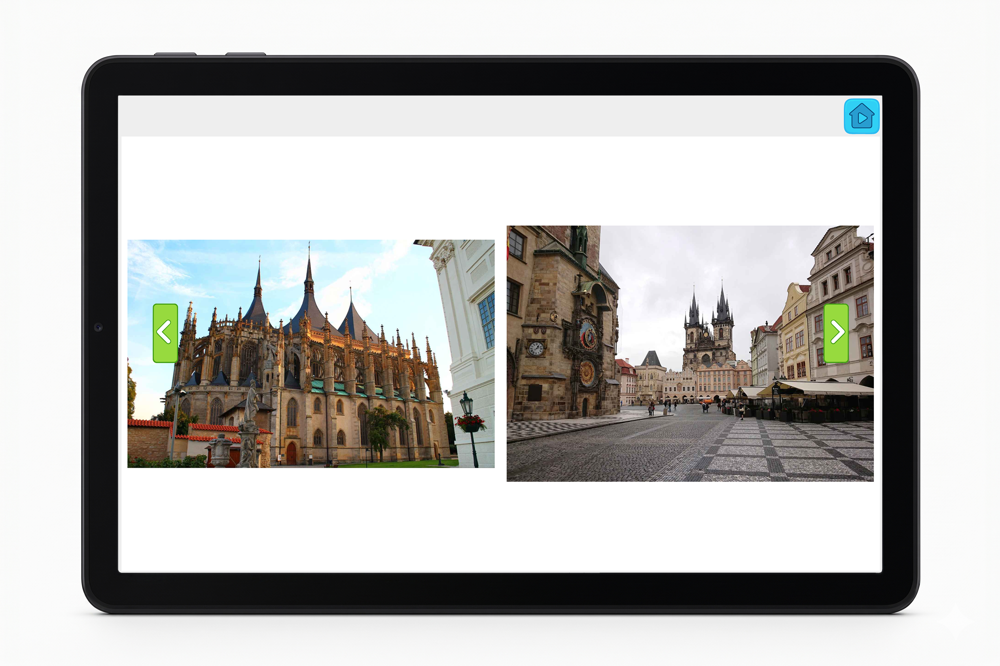
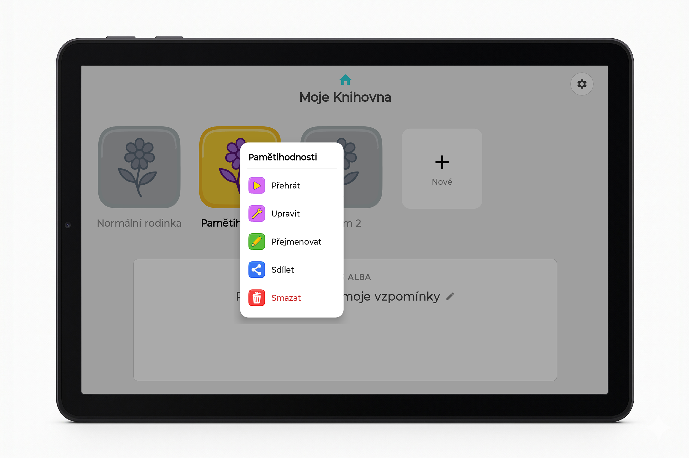
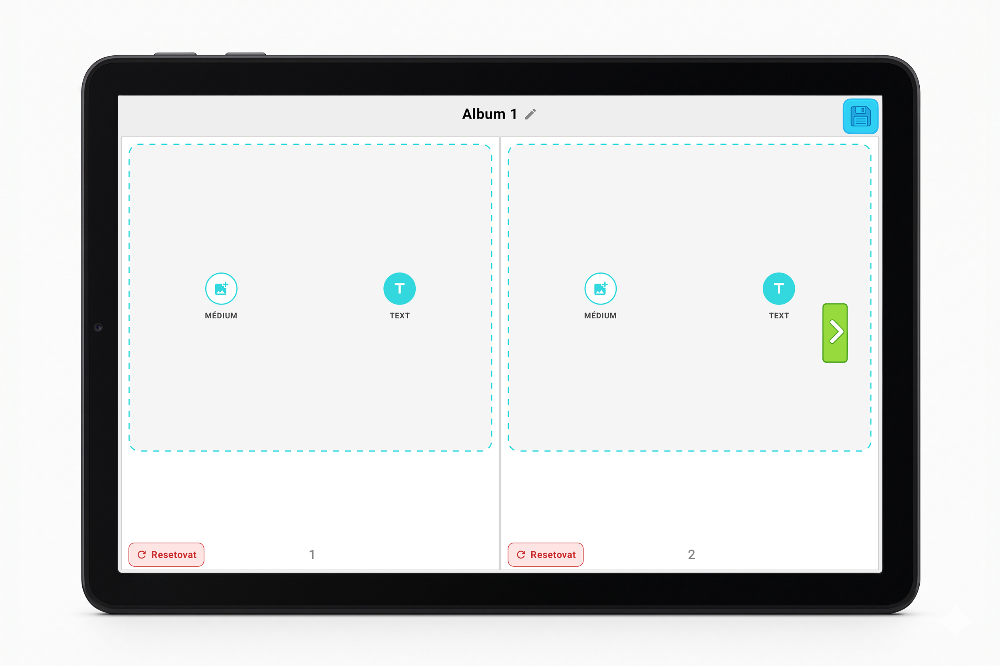

# BookCreator

**Multimediální alba s jednoduchým rozhraním pro tablet.**

[English](README.md) · [Všechny projekty](https://github.com/Dolik64)

## O projektu

Androidová aplikace vytvořená v rámci mého bakalářského projektu na FEL ČVUT. Odděluje přípravu alba od jeho prohlížení: rodinný příslušník nebo pečovatel může obsah uspořádat, zatímco přehrávač nabízí velké ovládací prvky a přehledné listování pro staršího uživatele.

## Hlavní funkce

- Vizuální knihovna alb a jejich správa.
- Editor stránek s textem, obrázky a multimediálním obsahem.
- Výběr rozložení stránky a samostatný přehrávač.
- Import a export balíčku alba včetně použitých médií.
- Sdílení alba přes systémové sdílení Androidu.
- Nastavení aplikace jako domovské obrazovky tabletu.

| Knihovna | Editor |
| --- | --- |
|  |  |

**Technologie:** Kotlin, Jetpack Compose, Material 3, ViewModel, Hilt, Media3, JSON.

Obrázky pocházejí z existujících prezentačních podkladů projektu a obsahují rámeček tabletu. [Obrazový průchod](docs/demo.md) ukazuje knihovnu, editor, přehrávač a nastavení. V tomto repozitáři není instalační APK ani webová verze aplikace.

Jde pouze o veřejnou prezentaci. Zdrojový kód Android aplikace ani soukromé výzkumné dokumenty zde nejsou.
