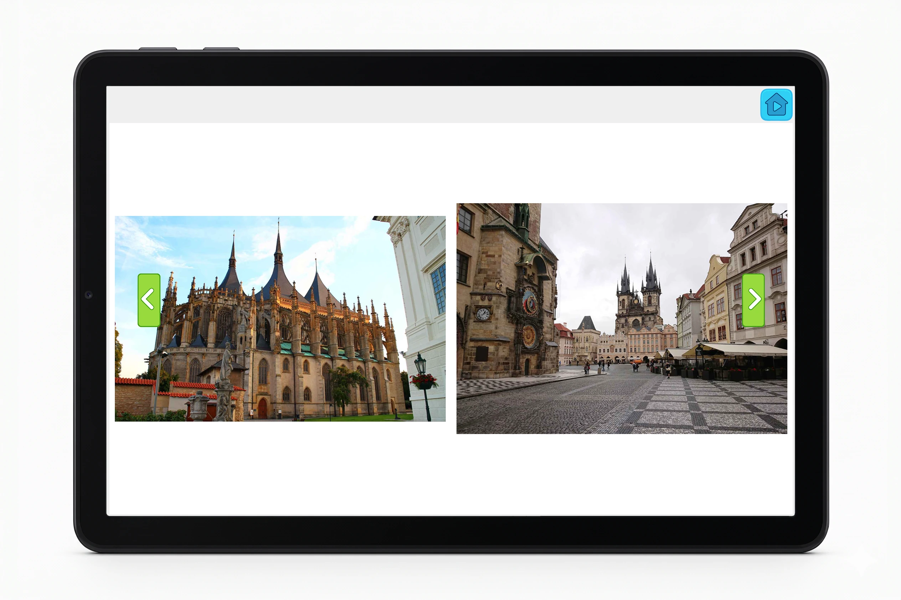
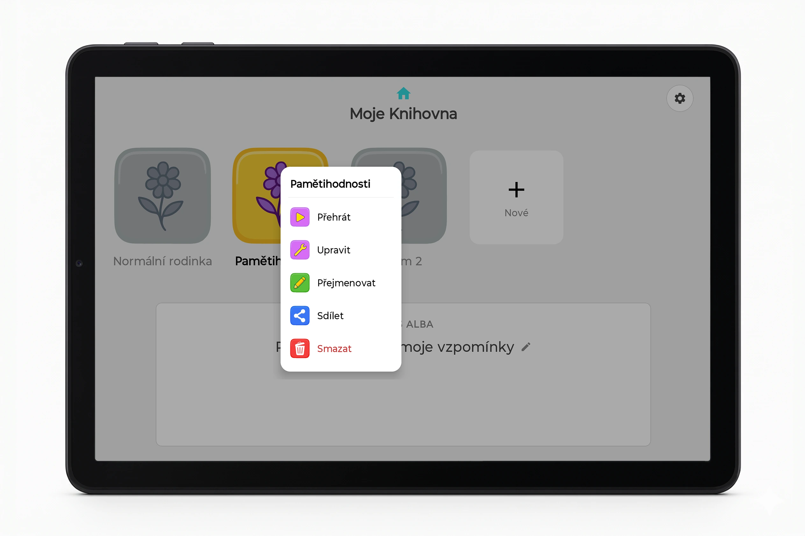
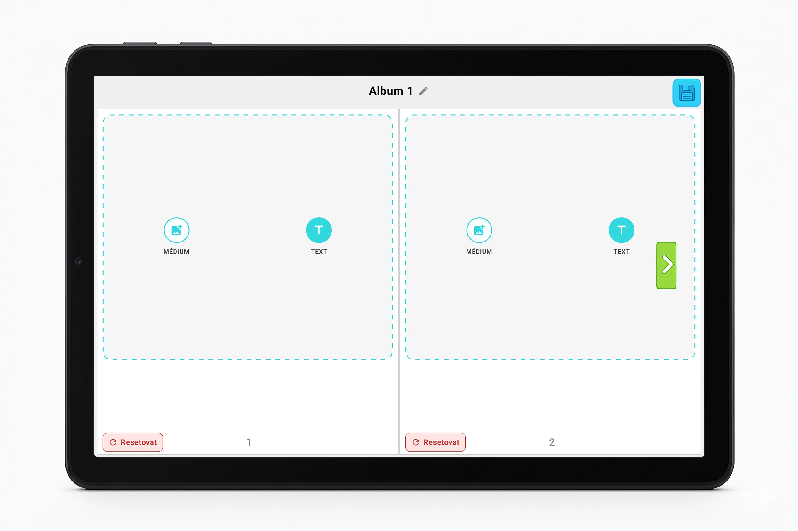

# BookCreator

**Multimedia albums with a tablet interface designed around straightforward interaction.**

[Visual demo](docs/demo.md) · [Česky](README.cs.md) · [All my projects](https://github.com/Dolik64)

## The project

BookCreator is an Android application developed as part of my bachelor project at the Faculty of Electrical Engineering, Czech Technical University in Prague.

The app separates preparation of an album from viewing it. A family member or caregiver can organise content, while the playback interface focuses on large controls and clear navigation for an older user.

## What it does

- Organise albums in a visual library.
- Create and edit pages with text, images and multimedia content.
- Choose page layouts and preview an album in a dedicated player.
- Import and export album packages with their referenced media.
- Share an album through Android's system sharing interface.
- Provide settings for use as a tablet's home application.

## Interface gallery

| Album library | Page editor |
| --- | --- |
|  |  |

The images are existing project presentation captures with tablet frames. They document the interface; they are not recordings from a new test session.

## Technical focus

**Kotlin · Jetpack Compose · Material 3 · ViewModel · Hilt · Media3 · JSON**

The project covers stateful Android UI, album and page modelling, media playback, local media handling and portable album sharing. The editor, library, settings and player provide distinct interaction contexts.

## Explore the demo

Follow the [visual walkthrough](docs/demo.md) to move from an album library to editing, playback and sharing. This showcase does not distribute an APK or offer a browser version of the Android app.

This repository contains presentation material only. The Android application source and private research documents are not included.
