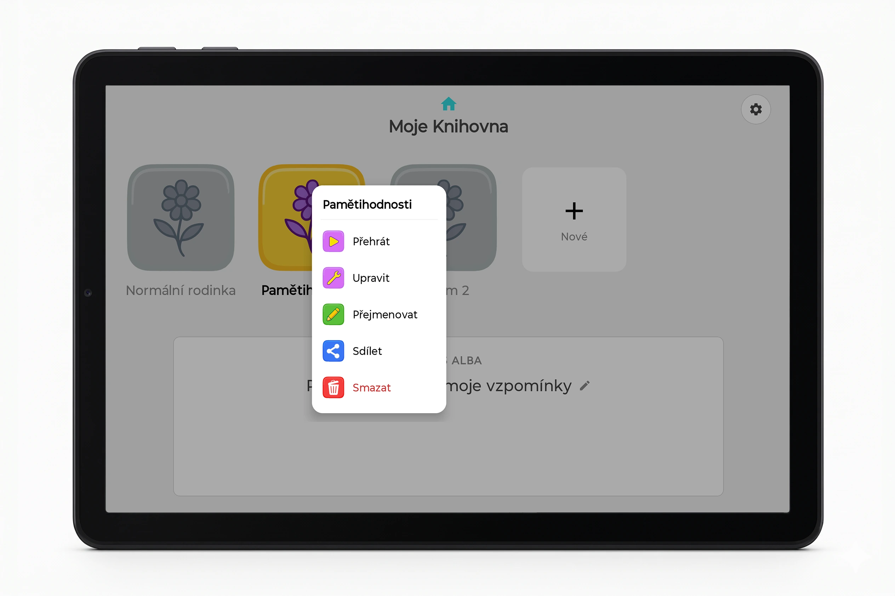
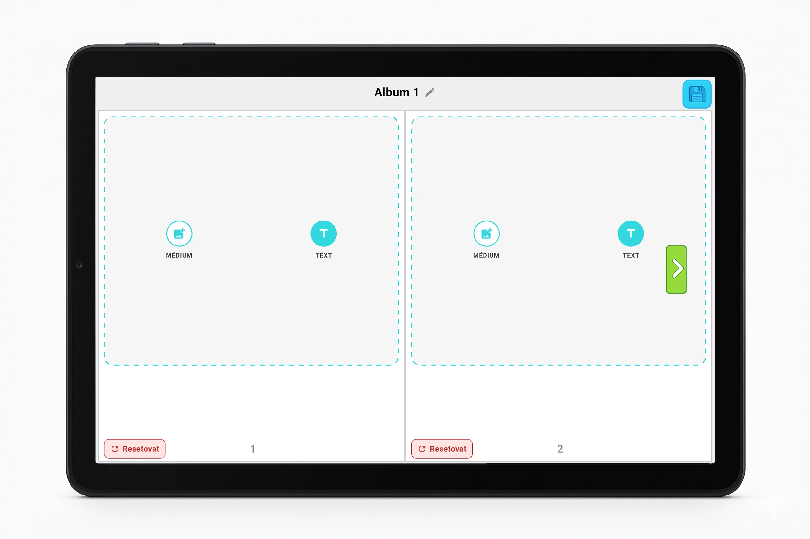
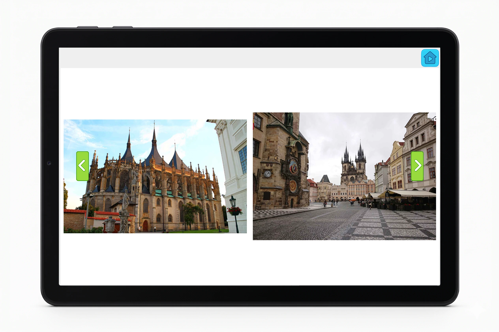
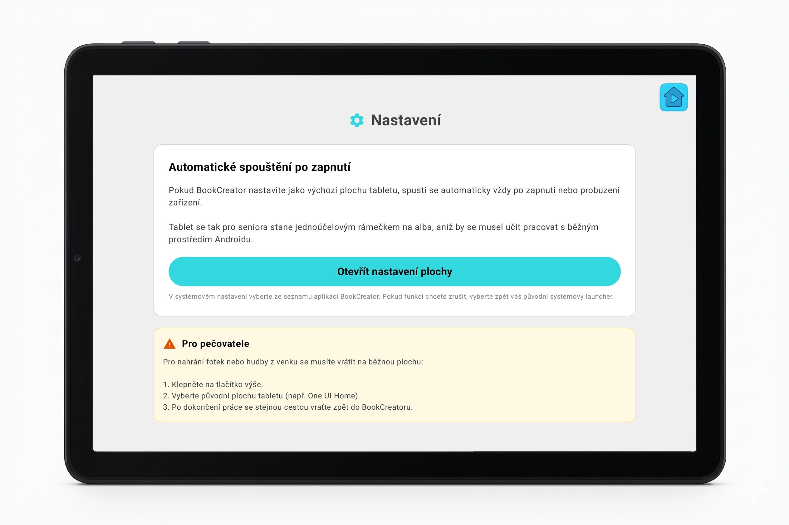

# Visual walkthrough — BookCreator

[Back to project](../README.md)

## 1. Choose an album

The library presents albums as large cards. Album actions group playback, editing, renaming, sharing and deletion in one menu.

## 2. Prepare the pages

The editor offers media and text slots, page navigation and an explicit save action. Preparation is separate from playback.

## 3. View the album

The player presents a spread with large previous and next controls, plus a route back to the library.

## 4. Configure the tablet

The settings screen explains how to choose BookCreator as the tablet's home application, and how a caregiver can return to the regular launcher.

## Sharing

An exported album packages its structured content and referenced media for transfer to another device running the application. The Android sharing menu supplies the destination app.

These are existing project presentation images. This walkthrough is a visual demonstration, not an installable release or a new device test report.
